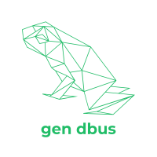
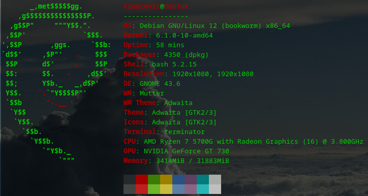

# Generate D-Bus



**gen_dbus** is a Clean Architecture Python generator tool for creating production-grade **[D-Bus IPC](overview.md)** projects in **C11**, **C++20**, and **Python 3.12+**.

Developed in **[python](https://www.python.org/)** code.

The README is used to introduce the modules and provide instructions on
how to install the modules, any machine dependencies it may have and any
other information that should be provided before the modules are installed.

[](https://github.com/vroncevic/gen_dbus/actions/workflows/gen_dbus_python_checker.yml) [](https://github.com/vroncevic/gen_dbus/actions/workflows/gen_dbus_package_checker.yml) [](https://github.com/vroncevic/gen_dbus/actions/workflows/gen_dbus_interface_checker.yml) [](https://github.com/vroncevic/gen_dbus/actions/workflows/gen_dbus_isp_checker.yml) [](https://github.com/vroncevic/gen_dbus/actions/workflows/gen_dbus_srp_checker.yml) [](https://github.com/vroncevic/gen_dbus/issues) [](https://github.com/vroncevic/gen_dbus/graphs/contributors)

<!-- START doctoc generated TOC please keep comment here to allow auto update -->
<!-- DON'T EDIT THIS SECTION, INSTEAD RE-RUN doctoc TO UPDATE -->
**Table of Contents**

- [🚀 Installation](#-installation)
    - [Install using pip](#install-using-pip)
    - [Install using build](#install-using-build)
    - [Install using py setup](#install-using-py-setup)
    - [Install using docker](#install-using-docker)
- [📦 Dependencies](#-dependencies)
- [📁 Tool structure](#-tool-structure)
  - [✨ Features](#-features)
- [📊 Code coverage](#-code-coverage)
- [🛠 Usage](#-usage)
- [📚 Docs](#-docs)
- [👥 Contributing](#-contributing)
- [📄 Copyright and licence](#-copyright-and-licence)

<!-- END doctoc generated TOC please keep comment here to allow auto update -->

### 🚀 Installation

Used next development environment



[](https://github.com/vroncevic/gen_dbus/actions/workflows/gen_dbus_python3_build.yml)

Currently there are four ways to install package:
* Install process based on using `pip` mechanism
* Install process based on `build` mechanism
* Install process based on `setup.py` mechanism
* Install process based on `docker` mechanism

##### Install using pip

**gen_dbus** is located at **[pypi.org](https://pypi.org/project/gen-dbus/)**.

You can install by using pip:

```bash
pip3 install gen-dbus
```

##### Install using build

Navigate to release **[page](https://github.com/vroncevic/gen_dbus/releases/)** download and extract release archive.

To install **gen_dbus** type the following:

```bash
tar xvzf gen_dbus-x.y.z.tar.gz
cd gen_dbus-x.y.z/
python3 -m pip install --upgrade setuptools pip build
pip3 install -r requirements.txt
python3 -m build --no-isolation --wheel
pip3 install ./dist/gen_dbus-*-py3-none-any.whl
```

##### Install using py setup

Navigate to release **[page](https://github.com/vroncevic/gen_dbus/releases/)** download and extract release archive.

To install **gen_dbus** locate and run `setup.py` with arguments:

```bash
tar xvzf gen_dbus-x.y.z.tar.gz
cd gen_dbus-x.y.z/
pip3 install -r requirements.txt
python3 setup.py install_lib
python3 setup.py install_data
python3 setup.py install_egg_info
```

##### Install using docker

You can use `Dockerfile` to create image/container.

### 📦 Dependencies

**gen_dbus** requires next modules and libraries:

* [ats-utilities - Python App/Tool/Script Utilities](https://pypi.org/project/ats-utilities/)

### 📁 Tool structure

**gen_dbus** is based on Clean / Hexagonal Architecture and SOLID principles:

<details>
<summary><b>Click to expand tool structure</b></summary>

```bash
    gen_dbus/
         ├── core/
         │   ├── __init__.py
         │   ├── model/
         │   │   ├── bus_type.py
         │   │   ├── dbus_role.py
         │   │   ├── __init__.py
         │   │   ├── project_setup.py
         │   │   └── project_type.py
         │   └── service/
         │       ├── engine.py
         │       ├── __init__.py
         │       ├── iservice.py
         │       └── isubprocessor.py
         ├── engine.py
         ├── infrastructure/
         │   ├── cli/
         │   │   ├── engine.py
         │   │   ├── icli.py
         │   │   ├── __init__.py
         │   │   └── setup/
         │   │       ├── bundle.py
         │   │       ├── dep_validator.py
         │   │       ├── dependencies.py
         │   │       ├── factory.py
         │   │       ├── __init__.py
         │   │       ├── keys.py
         │   │       ├── opt_validator.py
         │   │       ├── options.py
         │   │       ├── registry.py
         │   │       └── validator.py
         │   ├── command/
         │   │   ├── bundle.py
         │   │   ├── definition.py
         │   │   ├── executor.py
         │   │   ├── idefinition.py
         │   │   ├── iexecutor.py
         │   │   └── __init__.py
         │   ├── config/
         │   │   ├── gen_dbus.cfg
         │   │   ├── gen_dbus.logo
         │   │   ├── scheme.json
         │   │   └── templates.tgz
         │   ├── __init__.py
         │   ├── ischeme_builder.py
         │   ├── scheme_builder.py
         │   └── subprocessor.py
         ├── __init__.py
         ├── py.typed
         └── setup/
             ├── bundle.py
             ├── dep_validator.py
             ├── dependencies.py
             ├── factory.py
             ├── __init__.py
             ├── keys.py
             ├── opt_validator.py
             ├── options.py
             ├── registry.py
             └── validator.py

     10 directories, 50 files
```
</details>

#### ✨ Features

* Generates production-ready, wire-compatible D-Bus IPC projects across 3 stacks (`--type`):
  * `posix_c`: **C11** (`libdbus-1` vtable service + proxy client + CMake/Make).
  * `posix_cxx`: **C++20** (RAII wrappers over `libdbus-1` + CMake/Make).
  * `posix_py`: **Python 3.12+** (Clean Architecture + SOLID async `dbus-fast` server & client).
* Complete D-Bus Object Model out of the box: **Method Calls** (`Ping`, `SetStatus`), **Signals** (`StatusChanged`), **Properties** (`Status`, `CallCount`, `PropertiesChanged`), and **Introspection XML** (`org.freedesktop.DBus.Introspectable`).
* Flexible endpoint role filtering (`--role {both,client,server}`) and bus selection (`--bus {session,system}`).
* Strict SOLID & Hexagonal Architecture with structural `Protocol` interfaces, 10.00/10 `pylint` score, and 100% unit test coverage.

### 📊 Code coverage

<details>
<summary><b>Click to expand code coverage</b></summary>

| Name | Stmts | Miss | Cover |
|------|-------|------|-------|
| `gen_dbus/__init__.py` | 9 | 0 | 100%|
| `gen_dbus/core/__init__.py` | 9 | 0 | 100%|
| `gen_dbus/core/model/__init__.py` | 9 | 0 | 100%|
| `gen_dbus/core/model/bus_type.py` | 16 | 0 | 100%|
| `gen_dbus/core/model/dbus_role.py` | 17 | 0 | 100%|
| `gen_dbus/core/model/project_setup.py` | 19 | 0 | 100%|
| `gen_dbus/core/model/project_type.py` | 17 | 0 | 100%|
| `gen_dbus/core/service/__init__.py` | 9 | 0 | 100%|
| `gen_dbus/core/service/engine.py` | 34 | 0 | 100%|
| `gen_dbus/core/service/iservice.py` | 14 | 0 | 100%|
| `gen_dbus/core/service/isubprocessor.py` | 14 | 0 | 100%|
| `gen_dbus/engine.py` | 57 | 0 | 100%|
| `gen_dbus/infrastructure/__init__.py` | 9 | 0 | 100%|
| `gen_dbus/infrastructure/cli/__init__.py` | 9 | 0 | 100%|
| `gen_dbus/infrastructure/cli/engine.py` | 43 | 0 | 100%|
| `gen_dbus/infrastructure/cli/icli.py` | 16 | 0 | 100%|
| `gen_dbus/infrastructure/cli/setup/__init__.py` | 9 | 0 | 100%|
| `gen_dbus/infrastructure/cli/setup/bundle.py` | 23 | 0 | 100%|
| `gen_dbus/infrastructure/cli/setup/dep_validator.py` | 33 | 0 | 100%|
| `gen_dbus/infrastructure/cli/setup/dependencies.py` | 19 | 0 | 100%|
| `gen_dbus/infrastructure/cli/setup/factory.py` | 29 | 0 | 100%|
| `gen_dbus/infrastructure/cli/setup/keys.py` | 26 | 0 | 100%|
| `gen_dbus/infrastructure/cli/setup/opt_validator.py` | 33 | 0 | 100%|
| `gen_dbus/infrastructure/cli/setup/options.py` | 17 | 0 | 100%|
| `gen_dbus/infrastructure/cli/setup/registry.py` | 24 | 0 | 100%|
| `gen_dbus/infrastructure/cli/setup/validator.py` | 35 | 0 | 100%|
| `gen_dbus/infrastructure/command/__init__.py` | 9 | 0 | 100%|
| `gen_dbus/infrastructure/command/bundle.py` | 19 | 0 | 100%|
| `gen_dbus/infrastructure/command/definition.py` | 35 | 0 | 100%|
| `gen_dbus/infrastructure/command/executor.py` | 34 | 0 | 100%|
| `gen_dbus/infrastructure/command/idefinition.py` | 21 | 0 | 100%|
| `gen_dbus/infrastructure/command/iexecutor.py` | 15 | 0 | 100%|
| `gen_dbus/infrastructure/ischeme_builder.py` | 15 | 0 | 100%|
| `gen_dbus/infrastructure/scheme_builder.py` | 49 | 0 | 100%|
| `gen_dbus/infrastructure/subprocessor.py` | 78 | 0 | 100%|
| `gen_dbus/setup/__init__.py` | 9 | 0 | 100%|
| `gen_dbus/setup/bundle.py` | 25 | 0 | 100%|
| `gen_dbus/setup/dep_validator.py` | 33 | 0 | 100%|
| `gen_dbus/setup/dependencies.py` | 21 | 0 | 100%|
| `gen_dbus/setup/factory.py` | 46 | 0 | 100%|
| `gen_dbus/setup/keys.py` | 27 | 0 | 100%|
| `gen_dbus/setup/opt_validator.py` | 33 | 0 | 100%|
| `gen_dbus/setup/options.py` | 12 | 0 | 100%|
| `gen_dbus/setup/registry.py` | 24 | 0 | 100%|
| `gen_dbus/setup/validator.py` | 38 | 0 | 100%|
| **Total** | 1092 | 0 | 100% |

</details>

### 🛠 Usage

Install package:

```bash
pip3 install gen-dbus
```

Prepare main entry point by downloading [main.py](https://raw.githubusercontent.com/vroncevic/gen_dbus/dev/main.py) or running from repository root:

```bash
python3 main.py create --name telemetry_c --type posix_c --role both --bus session --output ./demo/posix_c
python3 main.py create --name telemetry_cxx --type posix_cxx --role both --bus session --output ./demo/posix_cxx
python3 main.py create --name telemetry_py --type posix_py --role both --bus session --output ./demo/posix_py
python3 main.py create --name sensor_cli --type posix_c --role client --bus system --output ./demo/client_only
python3 main.py create --name sensor_srv --type posix_cxx --role server --bus system --output ./demo/server_only
```

See [templates_guide.md](templates_guide.md) for full details on compiling and running generated D-Bus servers and clients.

### 📚 Docs

[](https://gen-dbus.readthedocs.io/en/latest/?badge=latest)

More documentation and info at:

* [D-Bus Templates Guide](templates_guide.md)
* [D-Bus Overview](overview.md)
* [D-Bus Bus Model](bus_model.md)
* [D-Bus Architecture](architecture.md)
* [gen-dbus.readthedocs.io](https://gen-dbus.readthedocs.io)
* [www.python.org](https://www.python.org/)

### 👥 Contributing

[Contributing to gen_dbus](CONTRIBUTING.md)

### 📄 Copyright and licence

[](https://www.gnu.org/licenses/gpl-3.0) [](https://opensource.org/licenses/Apache-2.0)

Copyright (C) 2021 - 2026 by [vroncevic.github.io/gen_dbus](https://vroncevic.github.io/gen_dbus)

**gen_dbus** is free software; you can redistribute it and/or modify
it under the same terms as Python itself, either Python version 3.x or,
at your option, any later version of Python 3 you may have available.

Lets help and support PSF.

[](https://www.python.org/psf/)

[](https://www.python.org/psf/donations/)
